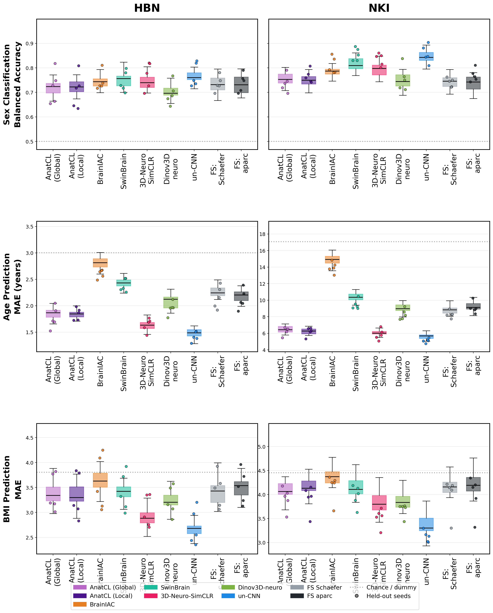

# BrainFMBench Leaderboard

Downstream probing of frozen features (RandomForest, held-out test).
Sex = balanced accuracy (higher is better); Age / BMI = MAE (lower is better).

_Boxes show 5-fold cross-validation across 5 seeds (25 values); overlaid points show held-out test results for the same 5 seeds._

**[Interactive version](https://www.epics-lab.ca/BrainFMBench/)**

| Model | Dataset | Sex (acc) | Age (MAE) | BMI (MAE) |
|-------|---------|-----------|-----------|-----------|
| un-CNN | NKI | 0.857 ± 0.032 | 5.11 ± 0.22 | 3.13 ± 0.11 |
| SwinBrain | NKI | 0.855 ± 0.023 | 9.47 ± 0.54 | 3.97 ± 0.20 |
| 3D-Neuro-SimCLR | NKI | 0.835 ± 0.023 | 5.86 ± 0.58 | 3.52 ± 0.17 |
| BrainIAC | NKI | 0.810 ± 0.031 | 13.96 ± 0.59 | 4.16 ± 0.25 |
| un-CNN | HBN | 0.772 ± 0.043 | 1.42 ± 0.08 | 2.70 ± 0.33 |
| FS aparc | NKI | 0.770 ± 0.023 | 9.09 ± 0.63 | 3.99 ± 0.36 |
| 3D-Neuro-SimCLR | HBN | 0.768 ± 0.049 | 1.64 ± 0.12 | 3.02 ± 0.29 |
| AnatCL (Local) | NKI | 0.765 ± 0.024 | 6.19 ± 0.47 | 3.92 ± 0.25 |
| Dinov3D-neuro | NKI | 0.757 ± 0.045 | 8.29 ± 0.57 | 3.69 ± 0.12 |
| SwinBrain | HBN | 0.744 ± 0.038 | 2.39 ± 0.11 | 3.41 ± 0.36 |
| BrainIAC | HBN | 0.744 ± 0.034 | 2.61 ± 0.07 | 3.59 ± 0.49 |
| FS Schaefer | NKI | 0.740 ± 0.016 | 8.29 ± 0.38 | 3.99 ± 0.35 |
| FS aparc | HBN | 0.740 ± 0.034 | 2.13 ± 0.17 | 3.51 ± 0.31 |
| AnatCL (Global) | NKI | 0.738 ± 0.031 | 6.26 ± 0.43 | 3.92 ± 0.22 |
| FS Schaefer | HBN | 0.736 ± 0.028 | 2.16 ± 0.19 | 3.44 ± 0.31 |
| AnatCL (Global) | HBN | 0.723 ± 0.060 | 1.78 ± 0.18 | 3.39 ± 0.33 |
| AnatCL (Local) | HBN | 0.707 ± 0.063 | 1.85 ± 0.10 | 3.34 ± 0.40 |
| Dinov3D-neuro | HBN | 0.696 ± 0.041 | 1.96 ± 0.11 | 3.23 ± 0.27 |

_Auto-generated from `models/*/results.json`. Do not edit by hand._