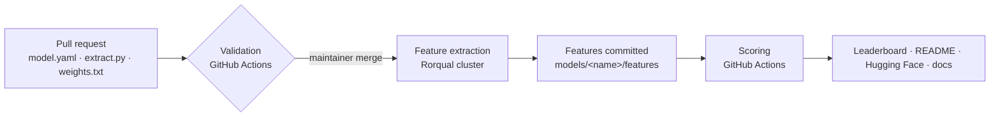

# How it works

BrainFMBench splits the work between a compute cluster and GitHub Actions, so the heavy part stays private and the scoring stays public.

1. **Validation** checks the folder name, `model.yaml`, the `extract` signature and the weight links, and runs `extract.py` on a synthetic volume.
2. **Extraction** runs on the Digital Research Alliance of Canada cluster against preprocessed scans. Only feature vectors leave the cluster, never images.
3. **Scoring** runs in public CI, so anyone can check how every number was produced.
4. **Publishing** rebuilds the leaderboard site, the README figure, the Hugging Face Space and these docs.

Only maintainer reviewed code runs on the cluster.
